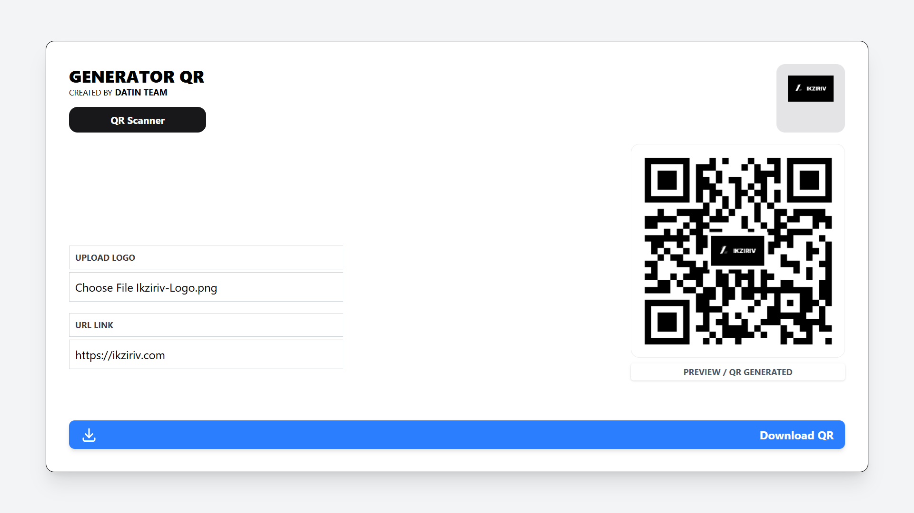

# URL QR Code Scanner

A simple, fast, and user-friendly web application to scan QR codes and instantly access the URLs they contain. Built with Svelte and Tailwind CSS.

[!Svelte](https://svelte.dev/)
[!Tailwind CSS](https://tailwindcss.com/)
[!Vite](https://vitejs.dev/)

## Table of Contents

- [Demo](#demo)
- [Features](#features)
- [Tech Stack](#tech-stack)
- [Getting Started](#getting-started)
- [Building](#building)
- [Contributing](#contributing)
- [License](#license)

## Demo

You can see a live demo of the application here:

**Live Demo**


## Features

- **Real-time QR Code Scanning**: Utilizes your device's camera to scan QR codes instantly.
- **URL Detection**: Automatically parses scanned QR codes to find and display valid URLs.
- **Copy to Clipboard**: Easily copy the detected URL with a single click.
- **Responsive Design**: A clean and intuitive interface that works seamlessly on desktop and mobile devices.
- **Fast and Lightweight**: Built with Svelte for optimal performance.

## Tech Stack

- **Frontend**: Svelte
- **Styling**: Tailwind CSS
- **Build Tool**: Vite

## Getting Started

To get a local copy up and running, follow these simple steps.

### Prerequisites

Make sure you have Node.js (version 18 or higher) and a package manager like npm or yarn installed.

### Installation

1.  Clone the repository:
    ```sh
    git clone https://github.com/your-username/url-qr-scanner.git
    ```
2.  Navigate to the project directory:
    ```sh
    cd url-qr-scanner
    ```
3.  Install NPM packages:
    ```sh
    npm install
    ```

### Running the Development Server

Once you've installed the dependencies, you can start the development server:

```bash
npm run dev

# or start the server and open the app in a new browser tab
npm run dev -- --open
```

## Building

To create a production version of your app:

```bash
npm run build
```

You can preview the production build with `npm run preview`.

> To deploy your app, you may need to install an [adapter](https://svelte.dev/docs/kit/adapters) for your target environment.
